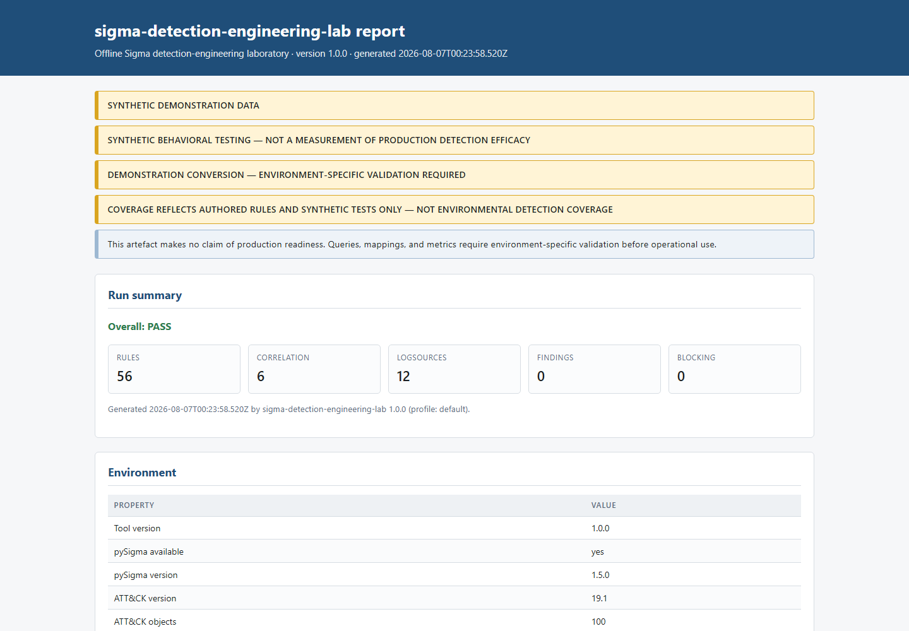
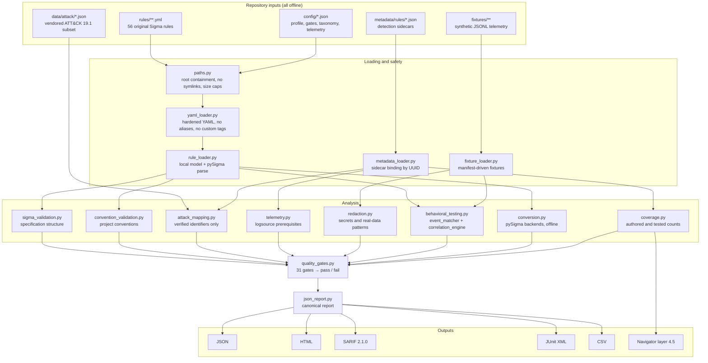

# sigma-detection-engineering-lab

[](https://github.com/salvomazzaglia/sigma-detection-engineering-lab/actions/workflows/ci.yml)
[](CHANGELOG.md)
[](LICENSE)
[](pyproject.toml)

An **offline detection-as-code laboratory** for authoring, validating, behaviorally
testing, documenting, mapping, comparing, and converting **original Sigma detection
rules** against **deterministic synthetic telemetry**.

> **SYNTHETIC DEMONSTRATION DATA**
>
> Every event, host, account, path, address, and query in this repository is generated
> for demonstration. No real organization, host, user, credential, log, alert, incident,
> or SIEM data is present. Nothing here is validated production detection content.

---

## Table of contents

| # | Section | # | Section |
|---|---------|---|---------|
| 1 | [What this project is](#1-what-this-project-is) | 21 | [Coverage methodology](#21-coverage-methodology) |
| 2 | [What this project is not](#2-what-this-project-is-not) | 22 | [Offline query conversion](#22-offline-query-conversion) |
| 3 | [Why it exists](#3-why-it-exists) | 23 | [Reports and output formats](#23-reports-and-output-formats) |
| 4 | [Screenshot](#4-screenshot) | 24 | [Exit codes](#24-exit-codes) |
| 5 | [Feature summary](#5-feature-summary) | 25 | [Comparison and regression tracking](#25-comparison-and-regression-tracking) |
| 6 | [Architecture](#6-architecture) | 26 | [Configuration](#26-configuration) |
| 7 | [Repository layout](#7-repository-layout) | 27 | [Safety model](#27-safety-model) |
| 8 | [Requirements](#8-requirements) | 28 | [Threat model summary](#28-threat-model-summary) |
| 9 | [Installation](#9-installation) | 29 | [Privacy and data handling](#29-privacy-and-data-handling) |
| 10 | [Quick start](#10-quick-start) | 30 | [Continuous integration](#30-continuous-integration) |
| 11 | [Command reference](#11-command-reference) | 31 | [Testing strategy](#31-testing-strategy) |
| 12 | [Detection philosophy](#12-detection-philosophy) | 32 | [Determinism and reproducibility](#32-determinism-and-reproducibility) |
| 13 | [Rule catalog](#13-rule-catalog) | 33 | [Pinned upstream versions](#33-pinned-upstream-versions) |
| 14 | [Rule anatomy](#14-rule-anatomy) | 34 | [Independence and attribution](#34-independence-and-attribution) |
| 15 | [Sidecar metadata](#15-sidecar-metadata) | 35 | [Known limitations](#35-known-limitations) |
| 16 | [Supported Sigma subset](#16-supported-sigma-subset) | 36 | [Roadmap](#36-roadmap) |
| 17 | [Correlation subset](#17-correlation-subset) | 37 | [Contributing](#37-contributing) |
| 18 | [Synthetic telemetry model](#18-synthetic-telemetry-model) | 38 | [Security policy](#38-security-policy) |
| 19 | [Quality gates](#19-quality-gates) | 39 | [License](#39-license) |
| 20 | [ATT&CK mapping](#20-attck-mapping) | 40 | [Documentation index](#40-documentation-index) |

---

## 1. What this project is

`sigma-detection-engineering-lab` is a self-contained laboratory that demonstrates the
full detection-engineering lifecycle as code:

1. A detection hypothesis is written down before the rule.
2. An **original** Sigma rule expresses that hypothesis.
3. A **sidecar metadata** document records telemetry prerequisites, tuning guidance,
   ATT&CK mapping, and evidence level.
4. **Synthetic fixtures** assert what the rule must match and — just as importantly —
   what it must *not* match.
5. A deterministic **behavioral matcher** executes those fixtures.
6. **Quality gates** turn authoring discipline into a build result.
7. **Offline conversion** through official pySigma backends demonstrates portability.
8. **Reports** (JSON, HTML, SARIF, JUnit, CSV, ATT&CK Navigator) make the result
   reviewable and diffable.

Version 1.0.0 ships **56 original rules** (50 standard, 6 correlation) across 12
logsources, **283 behavioral test cases**, and **31 quality gates**.

## 2. What this project is not

This project makes **no claim of production readiness**. Specifically, it is not:

- a SIEM, an alerting platform, or a rule deployment tool;
- a measurement of real-world detection efficacy;
- a claim of complete or representative MITRE ATT&CK coverage;
- an officially certified, endorsed, or SigmaHQ-published rule set;
- a substitute for a vendor backend's query semantics;
- a source of copied SigmaHQ community rules.

**A fixture match does not prove compromise.** A matching rule means a generated event
satisfied a written condition. It says nothing about whether equivalent real activity is
malicious, whether your environment produces the required fields, or whether the rule
would be tolerable at production volume.

## 3. Why it exists

Detection content is usually reviewed as prose. A rule is proposed, someone reads the
YAML, and it ships. The failure modes of that process are well known: rules that cannot
match anything the environment actually collects, false-positive sections that say
"Unknown", ATT&CK identifiers that were never checked against the framework, and
"stable" status assigned to content that was never tested at all.

This laboratory converts each of those failure modes into a build failure. The
underlying claim is narrow and defensible: **detection content can be held to the same
review, test, and release standards as application code**, and doing so is possible
entirely offline, without touching a single production log.

## 4. Screenshot



The standalone offline HTML report produced by
`sigma-detection-lab validate --html-out report.html`. Every generated artefact carries
the synthetic-data banner and the no-production-claim disclaimer verbatim.

## 5. Feature summary

| Capability | Detail |
|---|---|
| Rule catalog | 56 original Sigma rules: 16 Windows, 10 PowerShell, 12 identity, 12 Linux, 6 correlation |
| Specification | Sigma Rules Specification 2.1.0, parsed by pySigma 1.5.0 in addition to the local loader |
| Hardened parsing | Depth, node, alias, scalar, mapping, and sequence limits; duplicate keys and custom tags rejected |
| Behavioral testing | 253 single-event cases plus 30 correlation sequences, 283 results in total |
| Deterministic matcher | `sdel-lab-matcher-v1`, a documented Sigma subset with explicit case and modifier semantics |
| Correlation | `event_count`, `value_count`, `temporal`, `temporal_ordered` over synthetic sequences |
| Quality gates | 31 configurable gates spanning structure, convention, metadata, ATT&CK, fixtures, and secrets |
| ATT&CK | 36 techniques, 6 tactics, validated against a vendored ATT&CK Enterprise 19.1 subset |
| Conversion | Offline Splunk SPL and Elasticsearch Lucene demonstrations via official pySigma backends |
| Reports | JSON, standalone HTML, SARIF 2.1.0, JUnit XML, CSV, ATT&CK Navigator layer 4.5 |
| Comparison | Baseline-versus-current diffing with regression classification |
| CI | GitHub Actions on Ubuntu and Windows, Python 3.11 and 3.12, SHA-pinned actions |

## 6. Architecture



The dependency direction is deliberate: nothing in `Analysis` reaches back into
`Loading`, and nothing anywhere opens a socket. `json_report.py` is the single source of
truth — HTML, SARIF, JUnit, and CSV are renderings of the same canonical document, so
two formats can never disagree about a verdict.

Full detail: [`docs/architecture.md`](docs/architecture.md).

## 7. Repository layout

```
sigma-detection-engineering-lab/
├── config/                      Profiles, quality gates, taxonomy, telemetry, pins
├── data/attack/                 Vendored ATT&CK Enterprise 19.1 subset + version.json
├── docs/                        This documentation set
│   └── images/                  Report screenshot
├── examples/                    Deterministic sample rule, fixtures, reports, conversions
├── fixtures/                    Synthetic telemetry (JSONL) with per-rule manifests
│   ├── rules/<catalog-id>/      Standard-rule positive and negative cases
│   └── correlation/<catalog-id>/ Correlation positive and negative sequences
├── metadata/rules/              One detection sidecar per rule, named by catalog ID
├── rules/                       Original Sigma rules
│   ├── correlation/             SDEL-COR-001..006
│   ├── identity/                SDEL-ID-001..012
│   ├── linux/                   SDEL-LX-001..012
│   ├── powershell/              SDEL-PS-001..010
│   └── windows/                 SDEL-WIN-001..016
├── schemas/                     JSON Schemas for config, sidecars, fixtures, reports
├── scripts/                     Local CI orchestrator and generation helpers
├── src/sigma_detection_engineering_lab/  The package
├── tests/                       pytest suite
└── tools/                       Catalog generator and verifier
```

## 8. Requirements

- Python 3.11, 3.12, or 3.13
- No network access at runtime (only to install dependencies)
- No administrative privileges, no agent, no SIEM credentials

Runtime dependencies are pinned exactly: `pysigma==1.5.0`,
`pysigma-backend-splunk==2.1.0`, `pysigma-backend-elasticsearch==2.1.0`,
plus `jsonschema` and `PyYAML`.

## 9. Installation

```bash
git clone https://github.com/salvomazzaglia/sigma-detection-engineering-lab.git
cd sigma-detection-engineering-lab

python -m venv .venv
# Linux / macOS
source .venv/bin/activate
# Windows PowerShell
.\.venv\Scripts\Activate.ps1

python -m pip install --upgrade pip
python -m pip install -e ".[dev]"
```

The console entry point is `sigma-detection-lab`. The module form
`python -m sigma_detection_engineering_lab` is equivalent and is what CI uses.

pySigma is treated as **optional at runtime**. Without it the laboratory still loads,
validates structure, and runs behavioral tests; it reports honestly that upstream
specification parsing and conversion did not happen rather than silently passing.

## 10. Quick start

```bash
# Full verdict: validation, behavioral tests, conversion, and quality gates
sigma-detection-lab validate --strict

# Behavioral tests only, with a JUnit file for CI
sigma-detection-lab test --junit-out temp/tests.xml

# Browse the catalog
sigma-detection-lab list-rules --product windows --level high

# Everything known about one rule
sigma-detection-lab explain SDEL-WIN-001

# Coverage plus an ATT&CK Navigator layer
sigma-detection-lab coverage --tests --navigator temp/layer.json

# Offline Splunk conversion demonstration
sigma-detection-lab convert --backend splunk --output temp/splunk.json

# Reproduce the sample HTML report in the screenshot
sigma-detection-lab validate --html-out temp/report.html
```

## 11. Command reference

Nine commands are exposed. Every command accepts `--root`, `--profile`, `--rules`,
`--metadata`, `--fixtures`, and `--format {text,json}` unless noted.

| Command | Purpose | Notable options |
|---|---|---|
| `validate` | Run every validator, the behavioral suite, conversion, and the quality gates | `--strict`, `--skip-tests`, `--skip-conversion`, `--no-pysigma`, `--limit` |
| `test` | Run behavioral tests against synthetic fixtures | `--rule` (repeatable), `--verbose`, `--limit` |
| `list-rules` | List and filter the catalog | `--status`, `--level`, `--product`, `--category`, `--service`, `--technique`, `--tag`, `--search`, `--correlation` |
| `explain` | Show one rule's metadata, parsed condition, ATT&CK mapping, and fixture behaviour | positional rule identifier |
| `coverage` | Report authoring and testing coverage | `--tests`, `--navigator PATH` |
| `convert` | Offline backend conversion demonstration | `--backend` (repeatable), `--rule` (repeatable), `--output`, `--limit` |
| `compare` | Diff two saved JSON reports | positional `baseline` and `current`, `--fail-on-regression`, `--output`, `--verbose` |
| `generate-demo` | Write a complete example rule, sidecar, fixtures, and manifest | `--output`, `--force` |
| `version` | Report tool, dependency, ATT&CK, and pinned upstream versions | `--format json` |

`validate`, `test`, and `coverage` additionally accept the report writers `--json-out`,
`--html-out`, `--sarif-out`, `--junit-out`, and `--csv-out`.

Two flags deserve emphasis. `--skip-tests` and `--skip-conversion` do **not** make the
gates that judge those stages pass; they make them *unproven*, which fails. Skipping work
is never a route to a green build.

## 12. Detection philosophy

Six principles govern every rule in the catalog. They are enforced mechanically wherever
enforcement is possible.

1. **Hypothesis before rule.** Every sidecar states, in one sentence, what observable
   consequence the adversary behaviour has. A rule with no hypothesis is a pattern, not
   a detection.
2. **Behaviour over indicator.** Rules key on process lineage, path semantics, option
   combinations, and directory writability rather than on file names or hashes.
3. **Negative evidence is evidence.** Each rule carries at least three near-miss negative
   cases that each break exactly one requirement, so a regression in a single selection
   is caught by a specific, named case.
4. **Telemetry honesty.** A rule that requires Sysmon Event ID 10 says so, states what is
   lost without it, and names the collection gaps a real deployment will hit.
5. **No unearned confidence.** Sigma `status: stable` is blocked. Sidecar maturity cannot
   exceed `tested-synthetic`, because synthetic evidence supports nothing stronger.
6. **Tuning is part of the rule.** Every rule ships tuning guidance that preserves its
   detection value — typically per-binary exclusions rather than whole-directory ones.

Full detail: [`docs/detection-philosophy.md`](docs/detection-philosophy.md).

## 13. Rule catalog

| Family | Prefix | Count | Focus |
|---|---|---|---|
| Windows | `SDEL-WIN-001..016` | 16 | Process creation, defense evasion, persistence, system utilities |
| PowerShell | `SDEL-PS-001..010` | 10 | Script block content, encoded commands, host behaviour |
| Identity | `SDEL-ID-001..012` | 12 | Active Directory objects, privileged groups, audit policy |
| Linux | `SDEL-LX-001..012` | 12 | Persistence, permissions, shells, authentication |
| Correlation | `SDEL-COR-001..006` | 6 | Multi-event sequences over the base rules |

Catalog identifiers are stable and greppable. Each rule's Sigma `id` is derived
deterministically:

```
uuid.uuid5(uuid.NAMESPACE_URL,
  "https://github.com/salvomazzaglia/sigma-detection-engineering-lab/<catalog-id>")
```

so a UUID and its catalog identifier can always be re-derived from one another.

Browse the full list with `sigma-detection-lab list-rules`.

## 14. Rule anatomy

```yaml
title: 'Process Launched From Synthetic User-Writable Temporary Path'
id: a58d909c-bd70-51cc-8190-c6a67744b6bf
status: experimental
description: >-
    Detects a process image executing from a user-writable temporary or public directory
    in the synthetic lab environment. ... scored medium rather than high.
references:
    - 'https://attack.mitre.org/techniques/T1204/002/'
    - 'https://learn.microsoft.com/en-us/sysinternals/downloads/sysmon'
author: 'Salvatore Mazzaglia'
date: 2026-08-01
tags:
    - attack.execution
    - attack.t1204.002
logsource:
    category: process_creation
    product: windows
detection:
    selection_writable_path:
        Image|startswith:
            - 'C:\Synthetic\Users\synthetic-user\AppData\Local\Temp\'
            - 'C:\Synthetic\Windows\Temp\'
            - 'C:\Synthetic\Users\Public\'
    filter_approved_installer:
        Image|endswith: '\synthetic_patch_installer.exe'
    condition: 'selection_writable_path and not filter_approved_installer'
falsepositives:
    - >-
        Software installers and patch bundles that unpack to the per-user temporary
        directory before executing ...
level: medium
license: MIT
```

Note the conventions the gates enforce: named selections rather than `1 of them`,
specific false positives rather than "Unknown", at least one reference, an explicit
license, and a description that explains the severity choice.

Full detail: [`docs/rule-authoring-guide.md`](docs/rule-authoring-guide.md).

## 15. Sidecar metadata

The Sigma file stays portable and specification-compliant. Everything valuable to a
detection engineer but outside the specification lives in
`metadata/rules/<catalog-id>.json`: the detection hypothesis, required logs, channels
and fields, field semantics, collection prerequisites, expected collection gaps,
normalization assumptions, ingestion differences, retention considerations, expected
volume, false-positive strategy, tuning guidance, test strategy, fixture minimums,
ATT&CK mappings, backend support, related rules, maturity, and provenance.

Sidecars bind to rules by UUID, not by filename, so renaming a rule file cannot silently
orphan its metadata.

Full detail: [`docs/rule-authoring-guide.md`](docs/rule-authoring-guide.md) and
[`docs/logsource-and-telemetry.md`](docs/logsource-and-telemetry.md).

## 16. Supported Sigma subset

The laboratory validates against the full Sigma Rules Specification 2.1.0 through
pySigma, but its **own deterministic matcher** (`sdel-lab-matcher-v1`) implements a
documented subset:

- **Field modifiers:** `contains`, `startswith`, `endswith`, `re`, `cidr`, `exists`,
  `all`, `cased`
- **Condition operators:** `and`, `or`, `not`, parentheses, named selections,
  `1 of prefix*`, `all of prefix*`
- **Not supported:** unknown modifiers, aggregations, `near`, `gt`/`gte`/`lt`/`lte`,
  `expand`, backend-specific fields, arbitrary expressions
- **Case handling:** case-insensitive by default; case-sensitive under `cased`
- **Regex:** Python `re` flavour, 256-character limit, catastrophic-backtracking
  patterns rejected

Anything outside the subset is reported as `UNSUPPORTED` — never as a pass. The
`unsupported_not_counted_as_pass` gate exists specifically so an unevaluatable rule
cannot reach a green build, and the JUnit writer renders `UNSUPPORTED` as a *failure*
rather than a skip for the same reason.

Full detail: [`docs/sigma-specification-profile.md`](docs/sigma-specification-profile.md)
and [`docs/sigma-condition-subset.md`](docs/sigma-condition-subset.md).

## 17. Correlation subset

Four Sigma correlation types are evaluated over synthetic event sequences:
`event_count`, `value_count`, `temporal`, and `temporal_ordered`. Base rules and the
correlation document live in one multi-document YAML file; the correlation document is
the primary rule that the catalog tracks.

Every correlation negative sequence breaks exactly one of ordering, grouping, threshold,
or timespan, so a regression in window arithmetic is distinguishable from a regression in
grouping.

Full detail: [`docs/correlation-subset.md`](docs/correlation-subset.md).

## 18. Synthetic telemetry model

Fixtures are JSON Lines, one event per line, with `schema_version`, `event_id`,
`timestamp_utc`, `synthetic: true`, `platform`, `logsource`, `channel`, `provider`,
`host`, `user`, `fields`, `scenario`, and `notes`.

Only a fixed placeholder vocabulary is permitted: `SYNTHETIC-HOST-01`, `SYNTHETIC-DC01`,
`SYNTHETIC-LINUX-01`, `synthetic-user`, `synthetic-admin`, `synthetic-service`, the
`example.invalid` and `synthetic.invalid` domains, the `192.0.2.0/24` documentation
range, `C:\Synthetic\...`, `/tmp/synthetic-example`, `SYNTHETIC_ENCODED_PLACEHOLDER`,
and `https://example.invalid/synthetic` URLs.

There are no real credentials, no routable addresses, no executable payloads, and no
decodable encoded content — the encoded-command fixtures deliberately carry a
placeholder that decodes to nothing. The `no_real_data_patterns` and `no_secrets` gates
enforce this on every run.

Full detail: [`docs/synthetic-event-model.md`](docs/synthetic-event-model.md).

## 19. Quality gates

Thirty-one gates, configured in `config/quality-gates.json`, decide whether the catalog
passes. They cover structure (`safe_yaml_load`, `pysigma_parse`, `valid_filename`),
identity (`unique_uuid`, `unique_catalog_id`), authoring convention
(`non_empty_references`, `specific_falsepositives`, `status_experimental_or_test`,
`block_stable_status`), metadata (`sidecar_exists`, `detection_hypothesis_exists`,
`telemetry_requirements_exist`, `maturity_allowed`), ATT&CK
(`valid_attack_tags`, `verified_attack_technique_ids`), fixtures (minimum counts,
`all_positive_must_match`, `all_negative_must_reject`), and safety
(`synthetic_marker_required`, `no_real_data_patterns`, `no_secrets`,
`unsupported_not_counted_as_pass`).

Full detail: [`docs/rule-quality-gates.md`](docs/rule-quality-gates.md).

## 20. ATT&CK mapping

The catalog maps to **36 techniques across 6 tactics**, validated against a vendored
subset of **ATT&CK Enterprise 19.1** (STIX release `ATT&CK-v19.1`). Nothing is fetched at
runtime.

Two rules are absolute. First, a well-formed identifier is not a valid one: a
syntactically correct `T9999` that ATT&CK does not define is an invented identifier and
is rejected. Second, Detection Strategy (`DET####`), Analytic (`AN####`), and Data
Component (`DC####`) identifiers are recorded **only** when they were present in the
pinned extraction; otherwise the arrays stay empty and
`unmapped_defensive_objects_reason` explains why. Legacy ATT&CK Data Sources are
deprecated and are not used as a primary mapping anywhere.

**36 techniques is not coverage.** It is a count of authored rules, not a measurement of
what your environment can see. See
[`docs/coverage-methodology.md`](docs/coverage-methodology.md) before quoting any number
from this repository.

Full detail: [`docs/attack-mapping.md`](docs/attack-mapping.md) and
[`docs/attack-detection-model.md`](docs/attack-detection-model.md).

## 21. Coverage methodology

Coverage here counts **authored content and synthetic test completeness**, nothing else:
rules with sidecars, rules with verified ATT&CK mappings, rules with fixtures, and rules
fully tested. In 1.0.0 all four are 56 of 56.

Precision, recall, false-positive rate, and alert volume are **intentionally not
reported**. They cannot be derived from fixtures the author wrote to match the rules the
author wrote. Reporting them would be circular, and a circular metric is worse than no
metric because it looks authoritative.

Every coverage artefact carries the banner:

> COVERAGE REFLECTS AUTHORED RULES AND SYNTHETIC TESTS ONLY — NOT ENVIRONMENTAL DETECTION COVERAGE

## 22. Offline query conversion

Conversion runs entirely offline through the official pySigma backends and is a
**demonstration of portability, not a deployment artefact**. Every emitted query carries:

> DEMONSTRATION CONVERSION — ENVIRONMENT-SPECIFIC VALIDATION REQUIRED

Results for the 1.0.0 catalog:

| Backend | Package | Converted | Unsupported |
|---|---|---|---|
| `splunk` (SPL) | `pysigma-backend-splunk` 2.1.0 | 53 / 56 | 3 |
| `elasticsearch-lucene` | `pysigma-backend-elasticsearch` 2.1.0 | 50 / 56 | 6 |

The unsupported results are all correlation rules: the Splunk backend declines
`temporal_ordered`, and the Elasticsearch Lucene backend declines correlation rules
outright. Those failures are reported, not hidden — `conversion_status_recorded` requires
every attempt to end in a recorded status.

A converted query still needs field mappings, index and pipeline selection, permissions,
tuning, and validation before it means anything in a real deployment.

Full detail: [`docs/conversion-limitations.md`](docs/conversion-limitations.md),
[`docs/splunk-conversion.md`](docs/splunk-conversion.md),
[`docs/elasticsearch-conversion.md`](docs/elasticsearch-conversion.md), and
[`docs/tuning-and-deployment.md`](docs/tuning-and-deployment.md).

## 23. Reports and output formats

| Format | Flag | Notes |
|---|---|---|
| JSON | `--json-out` | Canonical document, schema `sigma-detection-engineering-lab/report/1.0.0` |
| HTML | `--html-out` | Standalone and offline: no CDN, no script, no external fonts |
| SARIF 2.1.0 | `--sarif-out` | Deliberately carries **no** `security-severity`; these are code-quality findings, not vulnerabilities |
| JUnit XML | `--junit-out` | `UNSUPPORTED` is rendered as a failure, never as a skip |
| CSV | `--csv-out` | Findings table, injection-safe |
| Navigator | `coverage --navigator` | Layer format 4.5; only verified techniques are included |

Full detail: [`docs/reports.md`](docs/reports.md).

## 24. Exit codes

| Code | Meaning |
|---|---|
| `0` | Everything requested succeeded |
| `1` | The analysis ran and something failed: a blocking finding, a failing test, or a failing gate |
| `2` | The command line itself was wrong |
| `3` | The laboratory refused to run: bad configuration, unsafe path, unreadable catalog |

A failing rule and a broken installation are different problems and never share an exit
code. Full detail: [`docs/exit-codes.md`](docs/exit-codes.md).

## 25. Comparison and regression tracking

```bash
sigma-detection-lab validate --json-out baseline.json
# ... make changes ...
sigma-detection-lab validate --json-out current.json
sigma-detection-lab compare baseline.json current.json --fail-on-regression
```

`compare` diffs tracked metrics, rule and technique sets, and gate states, classifying
each change as an improvement, a regression, or neutral. With `--fail-on-regression` it
returns exit code 1, which makes "coverage must not go backwards" a merge requirement.

## 26. Configuration

| File | Purpose |
|---|---|
| `config/default.config.json` | Paths, safety limits, required authors, allowed statuses, synthetic vocabulary |
| `config/demo.config.json` | The `demo` profile used by `generate-demo` and the examples |
| `config/quality-gates.json` | Which gates run and their thresholds |
| `config/allowed-taxonomy.json` | Permitted products, categories, services, levels, statuses, tags, modifiers |
| `config/evaluator-profile.json` | The documented matcher subset and regex safety settings |
| `config/telemetry-catalog.json` | Known logsource profiles, channels, providers, and field semantics |
| `config/conversion-backends.json` | Backend classes, dialects, and demonstration banners |
| `config/upstream-versions.json` | Pinned and verified upstream versions |

Select a profile with `--profile <name>`, which loads `config/<name>.config.json`.

Full detail: [`docs/configuration.md`](docs/configuration.md).

## 27. Safety model

- **No network at runtime.** No SIEM connection, no ATT&CK download, no telemetry.
- **No host log access.** The laboratory reads only files inside its own project root.
- **Path containment.** Every read resolves inside the root, symlinks are refused, path
  length and file size are capped.
- **Hardened YAML.** Depth 32, 5000 nodes, **zero** aliases, 8192-character scalars,
  512-entry mappings and sequences, duplicate keys rejected, custom tags rejected.
- **Regex safety.** 256-character limit and catastrophic-backtracking rejection in the
  matcher.
- **No code execution.** Fixtures are data. Nothing is `eval`ed, imported, or run.
- **Redaction.** Reports are scanned for credential-shaped strings before they are
  written.

Full detail: [`docs/security-and-privacy.md`](docs/security-and-privacy.md).

## 28. Threat model summary

The laboratory's realistic adversary is a **malicious or malformed repository file**
processed by a contributor or by CI. Modelled attacks include YAML bombs and alias
expansion, deeply nested structures, oversized files, symlink escape, path traversal,
catastrophic regex in a rule, HTML and CSV injection through rule text into reports, and
supply-chain compromise of a dependency or GitHub Action.

Explicitly out of scope: SIEM product vulnerabilities, production detection efficacy, and
anything requiring live connectivity.

Full detail: [`docs/threat-model.md`](docs/threat-model.md).

## 29. Privacy and data handling

No personal data, no real account names, no real hostnames, no routable IP addresses, and
no organizational identifiers exist in this repository. Placeholder identities use the
reserved `example.invalid` and `synthetic.invalid` domains and the `192.0.2.0/24`
documentation range from RFC 5737.

If you fork this laboratory and point it at your own content, the
`no_real_data_patterns` gate will flag routable addresses, non-example email domains, and
hostnames outside the synthetic vocabulary. That gate is a guard rail, not a guarantee:
review your own fixtures before publishing.

## 30. Continuous integration

GitHub Actions runs on `ubuntu-latest` and `windows-latest` against Python 3.11 and 3.12.
Actions are pinned to full commit SHAs, not tags:

```yaml
uses: actions/checkout@3d3c42e5aac5ba805825da76410c181273ba90b1 # v7.0.1
uses: actions/setup-python@5fda3b95a4ea91299a34e894583c3862153e4b97 # v7.0.0
```

The pipeline runs Ruff lint, Ruff format check, mypy strict, pytest, `validate --strict`,
the behavioral suite, coverage, both conversion demonstrations, the local CI orchestrator
`scripts/run-ci.py`, and a package build. `permissions: contents: read` is set at the
workflow level.

## 31. Testing strategy

Two independent layers:

- **Behavioral tests** assert rule semantics against synthetic fixtures. **283** unique
  behavioral cases in 1.0.0: **101** standard positives + **152** standard negatives +
  **12** correlation positive sequences + **18** correlation negative sequences
  (= **113** positive + **170** negative). The 30 correlation sequences are already
  included in those totals — they are not an extra set on top of 283.
- **Unit tests** (`pytest`) assert the laboratory's own behaviour: the YAML loader's
  limits, the condition parser's rejections, matcher semantics, correlation windows,
  redaction patterns, report determinism, and CLI exit codes. On Python 3.11 the suite
  collects **2789 pytest cases** (29 files, 2348 `test_*` functions, including
  parametrized validation cases). Do not read that number as 2789 hand-written tests.

Full detail: [`docs/behavioral-testing.md`](docs/behavioral-testing.md) and
[`docs/testing.md`](docs/testing.md).

## 32. Determinism and reproducibility

Reports are rendered with sorted keys and LF line endings; rules are sorted by catalog
identifier; fixtures carry fixed timestamps; UUIDs are derived rather than random; and
the ATT&CK subset is vendored rather than fetched. Two runs of the same commit on the
same Python version produce byte-identical output apart from the `generated_at`
timestamps.

## 33. Pinned upstream versions

Verified on **2026-08-07** and recorded in `config/upstream-versions.json`.

| Component | Version | Reference |
|---|---|---|
| Sigma Rules Specification | 2.1.0 (2025-08-02) | tag `v2.1.0`, commit `0c857d07da0e71eaaab2d667b3cce6f2c8469578` |
| Sigma Correlation Specification | 2.1.0 | Documented subset only |
| pySigma | 1.5.0 | `pysigma==1.5.0` |
| pySigma Splunk backend | 2.1.0 | `pysigma-backend-splunk==2.1.0`, dialect `spl` |
| pySigma Elasticsearch backend | 2.1.0 | `pysigma-backend-elasticsearch==2.1.0`, dialect `lucene` |
| MITRE ATT&CK Enterprise | 19.1 | STIX release `ATT&CK-v19.1`, dataset 2026-04-28 |
| ATT&CK Navigator layer format | 4.5 | Navigator 4.9.0 minimum, 5.1.0 documented |
| `actions/checkout` | v7.0.1 | `3d3c42e5aac5ba805825da76410c181273ba90b1` |
| `actions/setup-python` | v7.0.0 | `5fda3b95a4ea91299a34e894583c3862153e4b97` |

Full detail: [`docs/upstream-attribution.md`](docs/upstream-attribution.md).

## 34. Independence and attribution

**This project is independent of SigmaHQ and MITRE.**

- Sigma and SigmaHQ names are the property of their respective owners. This project
  claims no SigmaHQ certification, endorsement, or community-rule status. All rules here
  are **original work authored for this repository**, not copies of SigmaHQ community
  rules.
- pySigma and its backends are official SigmaHQ packages used unmodified under their
  upstream licenses (typically LGPL family).
- **ATT&CK® is a registered trademark of The MITRE Corporation.** Vendoring ATT&CK
  identifiers implies no MITRE certification, endorsement, or complete coverage.
- ATT&CK Navigator layers follow the published format; no Navigator endorsement is
  claimed.

See [`NOTICE.md`](NOTICE.md) and
[`docs/upstream-attribution.md`](docs/upstream-attribution.md).

## 35. Known limitations

1. The matcher is a documented subset, not a SIEM engine; its semantics are explicit and
   **may differ from vendor backends**.
2. Correlation support covers four types over in-memory sequences, without late-arriving
   events, watermarks, or out-of-order ingestion.
3. Correlation conversion is unsupported in 1.0.0: Splunk declines `temporal_ordered`,
   and Elasticsearch Lucene declines correlation entirely.
4. The ATT&CK subset is deliberately partial — only objects this project references, plus
   the tactics needed to interpret them.
5. Detection Strategies, Analytics, and Data Components are sparsely populated because
   identifiers absent from the pinned extraction are left empty rather than invented.
6. Coverage counts authored rules, not environmental visibility.
7. Behavioral results are evidence about the rule's logic, not about detection efficacy.
8. Field names follow common Sysmon and Windows Security conventions; real pipelines
   normalize differently and will require mapping.

## 36. Roadmap

Explicitly out of scope for 1.0 and recorded as roadmap only: live SIEM integration and
deployment, production log replay, EVTX and PCAP handling, malware samples, adversary
emulation, cloud provider APIs, machine learning and UBA, YARA and Suricata formats,
automatic SARIF upload, and SigmaHQ publication.

## 37. Contributing

Read [`CONTRIBUTING.md`](CONTRIBUTING.md) first. In short: rules must be original,
fixtures must be synthetic, ATT&CK identifiers must exist in the pinned catalog, and
`sigma-detection-lab validate --strict` must pass locally before you open a pull request.

## 38. Security policy

Report security issues privately as described in [`SECURITY.md`](SECURITY.md). Never
include real logs, credentials, or exploit payloads in a public issue.

## 39. License

MIT — see [`LICENSE`](LICENSE). Original code, original Sigma rules, synthetic fixtures,
and documentation are MIT licensed. Third-party dependencies retain their upstream
licenses; see [`NOTICE.md`](NOTICE.md).

Author: **Salvatore Mazzaglia** ([`salvomazzaglia`](https://github.com/salvomazzaglia)).

## 40. Documentation index

**Foundations**
[architecture](docs/architecture.md) ·
[detection-philosophy](docs/detection-philosophy.md) ·
[rule-authoring-guide](docs/rule-authoring-guide.md) ·
[development-plan](docs/development-plan.md)

**Sigma subset**
[sigma-specification-profile](docs/sigma-specification-profile.md) ·
[sigma-condition-subset](docs/sigma-condition-subset.md) ·
[correlation-subset](docs/correlation-subset.md)

**Telemetry and testing**
[synthetic-event-model](docs/synthetic-event-model.md) ·
[logsource-and-telemetry](docs/logsource-and-telemetry.md) ·
[behavioral-testing](docs/behavioral-testing.md) ·
[testing](docs/testing.md)

**Lifecycle and quality**
[rule-lifecycle](docs/rule-lifecycle.md) ·
[rule-quality-gates](docs/rule-quality-gates.md) ·
[false-positive-engineering](docs/false-positive-engineering.md)

**ATT&CK**
[attack-mapping](docs/attack-mapping.md) ·
[attack-detection-model](docs/attack-detection-model.md) ·
[coverage-methodology](docs/coverage-methodology.md)

**Conversion**
[conversion-limitations](docs/conversion-limitations.md) ·
[splunk-conversion](docs/splunk-conversion.md) ·
[elasticsearch-conversion](docs/elasticsearch-conversion.md) ·
[tuning-and-deployment](docs/tuning-and-deployment.md)

**Security**
[security-and-privacy](docs/security-and-privacy.md) ·
[threat-model](docs/threat-model.md) ·
[security-audit-v1.0.0](docs/security-audit-v1.0.0.md)

**Operations**
[configuration](docs/configuration.md) ·
[reports](docs/reports.md) ·
[exit-codes](docs/exit-codes.md) ·
[troubleshooting](docs/troubleshooting.md)

**Release**
[upstream-attribution](docs/upstream-attribution.md) ·
[final-release-checklist](docs/final-release-checklist.md) ·
[release-notes-v1.0.0](docs/release-notes-v1.0.0.md) ·
[CHANGELOG](CHANGELOG.md)
