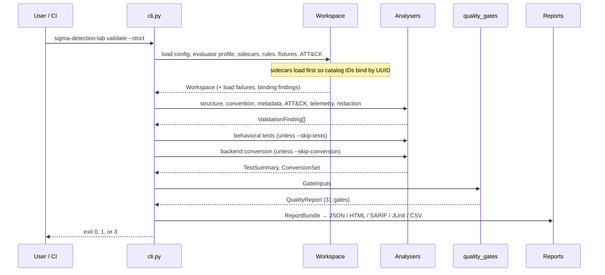

# Architecture

> SYNTHETIC DEMONSTRATION DATA — this document describes a laboratory that never
> connects to a SIEM and never reads host logs.

## Design goals

The architecture is shaped by four constraints, in priority order.

1. **Offline by construction.** No module opens a socket. Removing network capability
   from the design removes a whole class of accidental data exfiltration and makes the
   laboratory reproducible on an air-gapped machine.
2. **Honest failure.** Every stage that cannot complete reports *why*. A missing pySigma
   installation, an unsupported condition operator, or an ATT&CK catalog that failed to
   load produces an explicit, machine-readable statement rather than a silent pass.
3. **One source of truth.** The canonical JSON report is built once; HTML, SARIF, JUnit,
   and CSV are renderings of it. Two formats can never disagree about a verdict.
4. **Containment before parsing.** Path safety and structural limits are applied before
   any content is interpreted, so a hostile file is rejected before it can influence
   control flow.

## Layer model

```mermaid
flowchart LR
    subgraph L0["Layer 0 — Primitives"]
        E["errors.py"]
        S["severities.py"]
        ST["statuses.py"]
        K["constants.py"]
        PA["paths.py"]
    end
    subgraph L1["Layer 1 — Safe I/O"]
        Y["yaml_loader.py"]
        CF["config.py"]
    end
    subgraph L2["Layer 2 — Domain model"]
        MO["models.py"]
        EM["event_model.py"]
        CM["condition_model.py"]
        CP["condition_parser.py"]
    end
    subgraph L3["Layer 3 — Loaders"]
        RL["rule_loader.py"]
        ML["metadata_loader.py"]
        FL["fixture_loader.py"]
        AC["attack_catalog.py"]
        TC["telemetry.py"]
        RC["rule_catalog.py"]
    end
    subgraph L4["Layer 4 — Analysis"]
        SV["sigma_validation.py"]
        CV["convention_validation.py"]
        AM["attack_mapping.py"]
        MA["event_matcher.py"]
        CE["correlation_engine.py"]
        BT["behavioral_testing.py"]
        CO["conversion.py"]
        CG["coverage.py"]
        RD["redaction.py"]
    end
    subgraph L5["Layer 5 — Verdict"]
        QG["quality_gates.py"]
        CMP["comparison.py"]
    end
    subgraph L6["Layer 6 — Rendering"]
        JR["json_report.py"]
        HR["html_report.py"]
        SR["sarif_report.py"]
        JU["junit_report.py"]
        NV["navigator.py"]
        CN["console.py"]
    end
    CLI["cli.py"]

    L0 --> L1 --> L2 --> L3 --> L4 --> L5 --> L6 --> CLI
```

Imports only ever point downward. `models.py` does not know that reports exist;
`json_report.py` does not know that a CLI exists. The practical consequence is that the
analysis stages can be unit-tested without constructing a CLI namespace or touching the
filesystem beyond a temporary directory.

## Module responsibilities

### Layer 0 — Primitives

| Module | Responsibility |
|---|---|
| `errors.py` | The `SdelError` hierarchy. `PathSafetyError`, `YamlSafetyError`, `RuleLoadError`, `AttackCatalogError`, and friends all derive from it, which is what lets the CLI map any refusal to exit code 3. |
| `severities.py` | The ordered `Severity` scale (`informational` → `critical`), its SARIF mapping (SARIF has only note/warning/error), and HTML colours. |
| `statuses.py` | Two distinct vocabularies: upstream `SigmaStatus` and laboratory-local `Maturity`. Encodes that `stable` is blocked and that synthetic evidence supports nothing above `tested-synthetic`. |
| `constants.py` | The contractual banner strings. Reports must reproduce them verbatim. |
| `paths.py` | Root discovery, containment checks, symlink refusal, size and path-length caps, `iter_files`, `safe_read_text`, `relative_display`. |

### Layer 1 — Safe I/O

`yaml_loader.py` wraps PyYAML's safe loader with structural limits enforced during
construction rather than after: maximum depth, total node count, alias count (zero),
scalar length, mapping size, and sequence length. Duplicate mapping keys are rejected —
PyYAML silently keeps the last one, which would let a rule present one condition to a
reviewer and another to the parser. Untrusted tags are refused outright.

`config.py` resolves a profile name to `config/<profile>.config.json`, validates it
against `schemas/config.schema.json`, and exposes `LabConfig` with resolved directories
and a `Limits` object that every downstream loader consults.

### Layer 2 — Domain model

`models.py` holds the frozen dataclasses that everything else passes around: `LogSource`,
`Rule`, `TelemetryRequirement`, `AttackMapping`, `SidecarMetadata`, `FixtureCase`,
`CorrelationSequence`, `ValidationFinding`, `TestResult`, `TestSummary`,
`ConversionResult`, `GateResult`, `QualityReport`, `CoverageReport`.

`event_model.py` defines `SyntheticEvent`, including field resolution (a rule asks for
`Image`; the event may carry it in `fields`, or it may be a top-level attribute such as
`Channel`), timestamp parsing, and the invariant that every event is marked synthetic.

`condition_parser.py` turns a Sigma condition string into the AST defined in
`condition_model.py`. It is a real parser with a real grammar, not a regular expression,
which is what makes rejection of out-of-subset constructs reliable rather than
best-effort.

### Layer 3 — Loaders

`rule_loader.py` performs a two-stage load. The hardened YAML loader parses the file
under structural limits, and then pySigma is asked to parse the same text, so the rule is
validated against the official implementation rather than only this project's opinion of
the specification. pySigma's absence is a reportable condition, never a crash.

`metadata_loader.py` loads sidecars and — importantly — runs *before* the rule catalog is
built. A rule's catalog identifier comes from the sidecar that claims its UUID; building
the catalog first would index every rule under a filename-derived placeholder.

`fixture_loader.py` reads per-rule `manifest.json` files and the JSONL cases they name,
falling back to directory convention when a manifest is absent, and enforces
`max_events_per_fixture` and `max_correlation_sequence_events`.

`attack_catalog.py` merges every JSON file under `data/attack/`, accepting both a single
combined document and split files whose filename supplies the object type. A missing
directory yields an empty, *unavailable* catalog rather than an error — the rest of the
laboratory still runs, and mapping validation reports that identifiers could not be
verified.

`rule_catalog.py` indexes rules by catalog ID, UUID, and name; supplies the `RuleFilter`
used by `list-rules`; and emits uniqueness findings for duplicate identifiers.

### Layer 4 — Analysis

Nine analysers run independently and return `ValidationFinding` objects. None of them
raises to abort a run; a single broken rule produces findings while the remaining 55 are
still analysed.

- `sigma_validation.py` — specification structure: title, description, dates, logsource
  shape, detection block, and whether the rule falls inside the evaluator profile.
- `convention_validation.py` — project conventions: required author, license, UUID
  well-formedness, filename pattern, allowed statuses (blocking `stable`), specific false
  positives, non-empty references.
- `attack_mapping.py` — identifiers are well-formed, present in the vendored catalog,
  active (not deprecated or revoked), and consistent between Sigma tags and the sidecar.
- `telemetry.py` — the sidecar's declared logs, channels, and fields are actually
  provided by a profile in `config/telemetry-catalog.json`.
- `redaction.py` — two jobs: strip credential-shaped strings from report content, and
  detect non-synthetic data (routable addresses, real-looking hostnames, non-example
  email domains) in fixtures.
- `event_matcher.py` + `correlation_engine.py` + `behavioral_testing.py` — evaluate
  fixtures and produce `TestResult` objects.
- `conversion.py` — offline pySigma backend conversion with banners attached.
- `coverage.py` — authored and tested counts. Deliberately refuses to compute efficacy
  metrics.

### Layer 5 — Verdict

`quality_gates.py` takes a `GateInputs` bundle — config, catalog, metadata, fixtures,
findings, test summary, conversions, load failures — and produces one `GateResult` per
configured gate. Its most important behaviour is how it treats absent evidence: a gate
whose evidence was not produced (because the stage was skipped, or a dependency was
missing) is **unproven**, and unproven fails.

`comparison.py` diffs two saved JSON reports and classifies each delta as an improvement,
a regression, or neutral.

### Layer 6 — Rendering

`json_report.py` builds `ReportBundle` into the canonical document, applies redaction,
and attaches every banner and disclaimer. `html_report.py`, `sarif_report.py`,
`junit_report.py`, and the CSV writer all consume that same structure.
`navigator.py` builds an ATT&CK Navigator 4.5 layer, including only techniques verified
against the vendored catalog. `console.py` handles text rendering, including
UTF-8 reconfiguration for legacy Windows code pages.

## Execution flow: `validate`

## Cross-cutting decisions

**Sidecars bind by UUID, not filename.** Renaming a rule file cannot orphan its metadata.
The trade-off is one extra load pass before the catalog exists, which the loader ordering
above accommodates explicitly.

**Findings are data, not exceptions.** Analysers return findings rather than raising.
Exceptions are reserved for conditions that make the run itself meaningless — an
unreadable configuration, a path escape, a YAML bomb — and those map to exit code 3.

**Optional dependencies are first-class.** `pysigma_status()` caches one import attempt
per process and reports availability. A minimal environment still does useful work and
says exactly what it could not do.

**SARIF is a quality transport, not a vulnerability transport.** No rule descriptor
carries `security-severity`, every rule is tagged `detection-engineering` and `quality`,
and both the run and each descriptor state `isVulnerabilityFinding: false`. Reporting an
authoring convention as a security issue would be exactly the kind of inflation this
project avoids elsewhere.

**Unsupported is a failure, not a skip.** In JUnit output, `UNSUPPORTED` becomes a
`<failure>`. CI treats skips as acceptable, and a rule that cannot be evaluated must not
be able to reach a green build by being quietly skipped. Genuine skips — a rule with no
fixtures at all — are written as `<skipped>` and are caught instead by the fixture
minimum gates.

## What is deliberately absent

- No plugin loader, no dynamic import of user code, no `eval`.
- No network client of any kind.
- No writable state outside `temp/` and explicitly requested output paths.
- No global mutable singletons; configuration is passed explicitly.
- No efficacy metrics. See [coverage-methodology](coverage-methodology.md).

## Related documents

[detection-philosophy](detection-philosophy.md) ·
[sigma-specification-profile](sigma-specification-profile.md) ·
[rule-quality-gates](rule-quality-gates.md) ·
[reports](reports.md) ·
[threat-model](threat-model.md)
