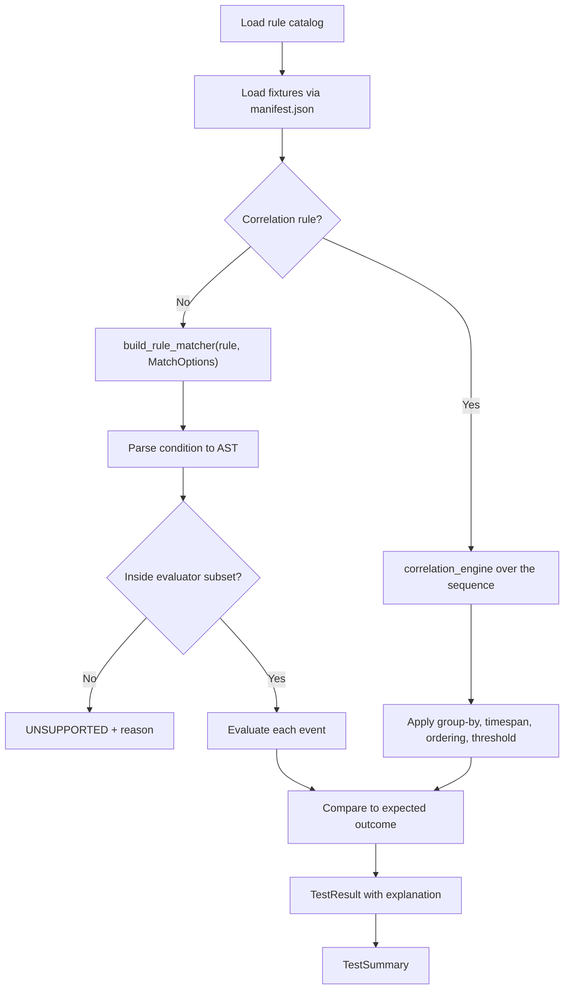

# Behavioral testing

> **SYNTHETIC BEHAVIORAL TESTING — NOT A MEASUREMENT OF PRODUCTION DETECTION EFFICACY**

## What a behavioral test asserts

A behavioral test asserts one thing: **given this synthetic event, does this rule's
condition evaluate as the author claimed?**

It does not assert that the rule detects real attacks, that the behaviour is malicious,
that your environment produces the fields, or that the alert volume is tolerable. A
passing suite means the rule's logic behaves as written. That is a real and useful
guarantee, and it is a smaller guarantee than "the detection works".

## Results in version 1.0.0

| Metric | Value |
|---|---|
| Evaluator | `sdel-lab-matcher-v1` |
| Total results | 283 |
| Positive expectations | 113 |
| Negative expectations | 170 |
| Passed | 283 |
| Failed / errored / unsupported / skipped | 0 / 0 / 0 / 0 |
| Single-event cases | 253 |
| Correlation sequences | 30 |

Negatives outnumber positives roughly three to two. That ratio is intentional: the
expensive failure in detection engineering is the rule that matches too much, and only
negative cases catch it.

## Outcome vocabulary

| Outcome | Meaning | JUnit rendering |
|---|---|---|
| `PASSED` | Actual matched expected | `<testcase>` |
| `FAILED` | Actual contradicted expected | `<failure>` |
| `ERROR` | Evaluation raised — bad fixture, uncompilable regex | `<error>` |
| `UNSUPPORTED` | The rule is outside the documented evaluator subset | **`<failure>`** |
| `SKIPPED` | No fixtures registered for the rule | `<skipped>` |

`UNSUPPORTED` becoming a *failure* is the most important mapping here. CI systems treat
skips as acceptable, so a rule that cannot be evaluated must not be able to reach a green
build by being quietly skipped. The `unsupported_not_counted_as_pass` gate enforces the
same idea at the verdict layer, and the JUnit header totals count unsupported results
among failures so the summary agrees with the case elements.

`SKIPPED` is reserved for the genuine case of a rule with no fixtures at all, which is
caught instead by the fixture-minimum gates.

## Execution model



`MatchOptions` is built from `config/evaluator-profile.json`, so matcher behaviour is
configuration, not a hard-coded constant, and a report can state which semantics produced
it.

## Fixture minimums

| Rule type | Positive | Negative | Gate |
|---|---|---|---|
| Standard | 2 | 3 | `minimum_positive_fixtures_standard`, `minimum_negative_fixtures_standard` |
| Correlation | 2 sequences | 2 sequences | `minimum_positive_sequences_correlation`, `minimum_negative_sequences_correlation` |

Most rules exceed the minimum. `SDEL-WIN-001` carries three positives and four negatives,
one negative per branch of its condition.

## Designing positive cases

Each positive should exercise a **different branch** of the condition, not the same
branch with cosmetic variation.

For `SDEL-WIN-001`, whose selection lists three writable path prefixes:

| Case | Branch |
|---|---|
| `case_01_user_temp_directory` | Per-user temporary directory |
| `case_02_machine_temp_directory` | Machine-wide Windows temporary directory |
| `case_03_public_directory` | Public profile directory |

Three positives that all hit the first prefix would give the same coverage as one.

## Designing negative cases

Each negative must be a **near miss** that breaks exactly one requirement. Walk the
condition and disable one clause at a time:

| Case | Requirement broken |
|---|---|
| `managed_program_files` | Path prefix outside every selection |
| `allowed_patch_installer` | Selection matches; the filter removes it |
| `system_directory_binary` | Path prefix is a non-writable system directory |
| `temp_named_subdirectory_elsewhere` | `startswith` semantics — a managed path merely containing "Temp" |

The last case earns its place by pinning a specific mistake. If `startswith` is ever
loosened to `contains`, exactly that case fails, and the case name states the regression.

## The manifest

```json
{
  "schema_version": "1.0.0",
  "catalog_id": "SDEL-WIN-001",
  "sigma_rule_id": "a58d909c-bd70-51cc-8190-c6a67744b6bf",
  "rule_file": "rules/windows/process_creation/process_launched_from_user_writable_temp_path.yml",
  "rule_type": "standard",
  "synthetic": true,
  "platform": "windows",
  "logsource": { "category": "process_creation", "product": "windows" },
  "channels": ["Microsoft-Windows-Sysmon/Operational", "Security"],
  "minimum_positive_cases": 2,
  "minimum_negative_cases": 3,
  "positive_cases": [
    {
      "name": "user_temp_directory",
      "file": "positive/case_01_user_temp_directory.jsonl",
      "expected": "match",
      "scenario": "Binary executed from the per-user temporary directory.",
      "rationale": "Image prefix matches the per-user temporary directory selection."
    }
  ],
  "negative_cases": [ /* ... */ ],
  "generated_by": "tools/generate_all_rules.py",
  "notes": "All events are synthetic. Negative cases are deliberate near misses that exercise one failing selection each."
}
```

`rationale` is the field a reviewer reads. `scenario` says what happened; `rationale`
says why the expected outcome is the correct one. A case whose rationale cannot be
written in one sentence is usually testing two things at once.

Fixtures can also be discovered by directory convention when no manifest is present, but
the manifest is preferred because it makes expectations explicit and reviewable in a
diff.

## Running tests

```bash
# Whole catalog
sigma-detection-lab test

# One rule, with every result listed
sigma-detection-lab test --rule SDEL-WIN-001 --verbose

# Several rules
sigma-detection-lab test --rule SDEL-WIN-001 --rule SDEL-COR-003

# CI output
sigma-detection-lab test --junit-out temp/tests.xml --json-out temp/tests.json
```

Exit code 0 when every result passed; exit code 1 on any failure, error, or unsupported
result.

## Diagnosing a failure

`explain` is the fastest loop, because it shows the parsed condition alongside per-case
verdicts and the matcher's reasoning:

```bash
sigma-detection-lab explain SDEL-WIN-001
```

```
Parsed condition
  (selection_writable_path AND NOT filter_approved_installer)

Fixture behaviour
SYNTHETIC BEHAVIORAL TESTING — NOT A MEASUREMENT OF PRODUCTION DETECTION EFFICACY

  Verdict   Kind      Case                      Actual     Why
  ok        positive  user_temp_directory       match      selection_writable_path matched Image
  ok        negative  allowed_patch_installer   no match   filter_approved_installer matched
```

Read the failure in this order:

1. **Is the parsed condition what you meant?** If not, the rule is wrong even if tests
   pass.
2. **Does the event carry the field?** A missing field is absent, not empty, and does not
   match.
3. **Is it a case-sensitivity issue?** Default is insensitive; `cased` changes that.
4. **Is it wildcard or `startswith` semantics?** The most common cause of an
   unintentionally broad match.
5. **For correlation, which property broke?** The negative case name tells you: ordering,
   grouping, threshold, or timespan.

## Determinism

Behavioral results are byte-reproducible. Timestamps in fixtures are fixed, events are
evaluated in file order, ties in correlation ordering are broken by file position, and
the report is rendered with sorted keys and LF line endings. The same commit on the same
Python version yields identical output apart from `generated_at`.

## What behavioral testing cannot tell you

- **Efficacy.** Precision and recall cannot be computed from fixtures written by the same
  person who wrote the rules. The circularity is total, and reporting the numbers anyway
  would be worse than reporting nothing.
- **Volume.** No fixture count predicts how many events per day a rule would match.
- **Field availability.** A passing rule may reference a field your pipeline drops.
- **Backend agreement.** The matcher's semantics are explicit and may differ from a
  vendor engine's; see [conversion-limitations](conversion-limitations.md).
- **Maliciousness.** A match is an observation. **A match does not prove compromise.**

## Related documents

[synthetic-event-model](synthetic-event-model.md) ·
[sigma-condition-subset](sigma-condition-subset.md) ·
[correlation-subset](correlation-subset.md) ·
[rule-quality-gates](rule-quality-gates.md) ·
[testing](testing.md)
