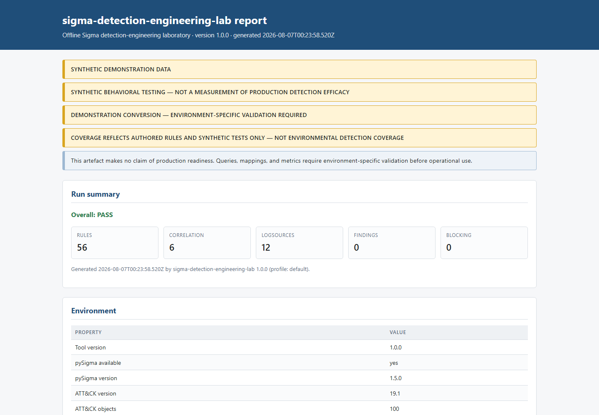

# Reports

Six output formats. All are derived from one canonical JSON document, so two formats can
never disagree about a verdict.

## Formats

| Format | Flag | Consumer |
|---|---|---|
| JSON | `--json-out` | Canonical; input to `compare` |
| HTML | `--html-out` | Human review, standalone and offline |
| SARIF 2.1.0 | `--sarif-out` | Code-quality tooling |
| JUnit XML | `--junit-out` | CI test reporting |
| CSV | `--csv-out` | Spreadsheet triage of findings |
| Navigator layer | `coverage --navigator` | ATT&CK Navigator 4.5 |

```bash
sigma-detection-lab validate \
  --json-out temp/report.json \
  --html-out temp/report.html \
  --sarif-out temp/report.sarif \
  --junit-out temp/tests.xml \
  --csv-out temp/findings.csv
```

Pre-generated examples live in `examples/`.

## The canonical JSON report

Schema identifier: `sigma-detection-engineering-lab/report/1.0.0`.

Top-level keys:

| Key | Contents |
|---|---|
| `schema` | Schema identifier |
| `project` | Project name and profile |
| `generated_at` | UTC ISO-8601 timestamp |
| `command` | The command that produced the report |
| `environment` | Tool version, pySigma availability and version |
| `catalog` | Rule counts, logsource count, duplicate counts |
| `metadata` | Sidecar counts and binding results |
| `fixtures` | Case and sequence counts, manifest usage, load errors |
| `validation` | Findings, counts by severity, error and warning totals |
| `tests` | Behavioral summary and per-result detail |
| `coverage` | Authoring and testing coverage, excluded metrics |
| `quality` | Gate results |
| `attack_catalog` | ATT&CK version, object counts, load errors |
| `banners` | All four contractual banners |
| `disclaimer` | `NO_PRODUCTION_CLAIM`, verbatim |
| `production_ready` | Always `false` |
| `passed` | The overall verdict |

Example excerpt:

```json
{
  "schema": "sigma-detection-engineering-lab/report/1.0.0",
  "passed": true,
  "production_ready": false,
  "environment": {
    "tool_version": "1.0.0",
    "pysigma_available": true,
    "pysigma_version": "1.5.0"
  },
  "catalog": { "total": 56, "standard": 50, "correlation": 6, "logsources": 12,
               "duplicate_uuids": 0, "duplicate_catalog_ids": 0 },
  "fixtures": { "case_count": 253, "sequence_count": 30, "error_count": 0,
                "manifest_used": true },
  "tests": { "evaluator": "sdel-lab-matcher-v1", "total": 283, "passed": 283,
             "failed": 0, "errored": 0, "unsupported": 0, "skipped": 0 },
  "quality": { "gate_count": 31, "failed_gate_count": 0, "passed": true }
}
```

`production_ready: false` is a literal, not a computed value. There is no input that makes
it `true`.

Rendered with `sort_keys=True`, `ensure_ascii=False`, and LF endings, so two runs of the
same commit differ only in `generated_at`.

## Findings

```json
{
  "code": "SDEL-META-004",
  "category": "metadata",
  "severity": "high",
  "subject": "SDEL-WIN-017",
  "message": "sidecar declares required field 'ProcessGuid' which no declared source provides",
  "path": "metadata/rules/SDEL-WIN-017.json",
  "line": null,
  "gate": "telemetry_requirements_exist",
  "remediation": "Add the field to a telemetry profile in config/telemetry-catalog.json, or remove it from required_fields."
}
```

`gate` is the important field: it connects a finding to the gate it will fail, so a
reviewer can go from a red gate to the specific findings beneath it.

Code prefixes: `SDEL-LOAD` (loading), `SDEL-STRUCT` (specification structure),
`SDEL-CONV` (convention), `SDEL-META` (sidecar), `SDEL-ATTACK` (mapping),
`SDEL-TELEM` (telemetry), `SDEL-FIX` (fixtures), `SDEL-SEC` (secrets and real data).

## HTML

Standalone and offline: no CDN, no external font, no script tag, no network request when
opened. That is a security property as much as a convenience one.

Contents: header with project, profile, timestamp, and verdict; all four banners; catalog
and fixture summaries; the gate table; findings grouped by severity with the colour scale
from `severities.py`; the behavioral summary; and coverage with its caveat banner.

All interpolated values are HTML-escaped — rule text is untrusted input.



## SARIF 2.1.0

SARIF is used here as a **code-quality transport, not a vulnerability transport**. Every
finding describes the quality of detection content; none describes an exploitable
weakness.

The document asserts this explicitly rather than leaving it to interpretation:

```json
{
  "properties": {
    "category": "detection-engineering-quality",
    "isVulnerabilityFinding": false,
    "note": "These results describe the quality of detection content. They are not vulnerability findings and carry no security severity.",
    "productionReady": false
  }
}
```

- **No rule carries `security-severity`**, so findings do not appear as security alerts or
  contribute to a security score.
- Every rule is tagged `detection-engineering`, `quality`, `sigma`, and its category.
- The run and every rule descriptor carry the properties above.

Severity maps to SARIF's three levels: `informational` and `low` → `note`, `medium` →
`warning`, `high` and `critical` → `error`.

Getting this wrong would misrepresent an authoring convention as a security issue.

## JUnit XML

```xml
<?xml version="1.0" encoding="UTF-8"?>
<!-- SYNTHETIC BEHAVIORAL TESTING — NOT A MEASUREMENT OF PRODUCTION DETECTION EFFICACY -->
<testsuites name="sigma-detection-engineering-lab" tests="283" failures="0" errors="0" skipped="0" time="0.412000">
  <testsuite name="SDEL-WIN-001" tests="7" failures="0" errors="0" skipped="0" time="0.010000">
    <properties>
      <property name="evaluator" value="sdel-lab-matcher-v1"/>
      <property name="data-source" value="SYNTHETIC BEHAVIORAL TESTING — NOT A MEASUREMENT OF PRODUCTION DETECTION EFFICACY"/>
    </properties>
    <testcase name="positive::user_temp_directory" classname="SDEL-WIN-001" time="0.001000"/>
  </testsuite>
</testsuites>
```

One suite per rule, one case per fixture. The mapping that matters:

| Outcome | Element |
|---|---|
| `PASSED` | `<testcase>` |
| `FAILED` | `<failure type="behavioral-expectation">` |
| `ERROR` | `<error type="evaluation-error">` |
| `UNSUPPORTED` | **`<failure type="unsupported-construct">`** |
| `SKIPPED` | `<skipped>` |

`UNSUPPORTED` becomes a failure because CI treats skips as acceptable, and a rule that
cannot be evaluated must not reach a green build by being quietly skipped. The header
totals count unsupported among failures so the summary agrees with the case elements.

## CSV

A flat findings table: severity, code, category, subject, message, path, gate,
remediation.

Injection-safe: leading `=`, `+`, `-`, and `@` are neutralised so a spreadsheet cannot
execute a formula embedded in rule text.

## ATT&CK Navigator layer

```bash
sigma-detection-lab coverage --tests --navigator temp/layer.json
```

Layer format **4.5** (Navigator 4.9.0 minimum, 5.1.0 documented). Two enforced properties:

1. Only techniques verified against the vendored ATT&CK subset appear. Unverified
   techniques are omitted and listed separately in the console output, so the omission is
   visible.
2. **Scores reflect rule count, not detection confidence.**

Navigator layers are visually persuasive in a way tables are not. Anyone presenting one
should say what it counts. See [coverage-methodology](coverage-methodology.md).

## Banners

Four contractual strings, reproduced verbatim wherever they apply:

| Banner | Applies to |
|---|---|
| `SYNTHETIC DEMONSTRATION DATA` | Any artefact derived from generated telemetry |
| `SYNTHETIC BEHAVIORAL TESTING — NOT A MEASUREMENT OF PRODUCTION DETECTION EFFICACY` | Behavioral results |
| `COVERAGE REFLECTS AUTHORED RULES AND SYNTHETIC TESTS ONLY — NOT ENVIRONMENTAL DETECTION COVERAGE` | Coverage output |
| `DEMONSTRATION CONVERSION — ENVIRONMENT-SPECIFIC VALIDATION REQUIRED` | Every converted query |

Plus the long-form disclaimer:

> This artefact makes no claim of production readiness. Queries, mappings, and metrics
> require environment-specific validation before operational use.

They are contractual because a report separated from its context is exactly how a
synthetic result becomes a production claim.

## Comparison

```bash
sigma-detection-lab compare baseline.json current.json --fail-on-regression
```

Diffs tracked metrics, rule and technique sets, and gate states, classifying each change
as an improvement, a regression, or neutral. With `--fail-on-regression`, a regression
returns exit code 1, making "coverage must not go backwards" a merge requirement.

## Redaction

All findings pass through `redact_findings()` before writing. Credential-shaped strings
quoted from rule or fixture text are replaced, so a report — including a SARIF file
uploaded to a scanning service — cannot leak a secret that a gate also flagged.

## Related documents

[exit-codes](exit-codes.md) ·
[rule-quality-gates](rule-quality-gates.md) ·
[coverage-methodology](coverage-methodology.md) ·
[security-and-privacy](security-and-privacy.md)
