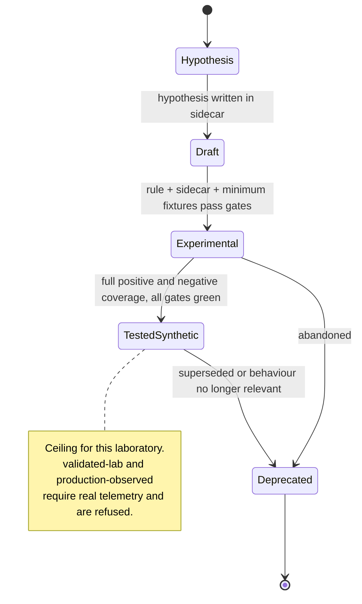

# Rule lifecycle

How a rule enters the catalog, moves through evidence levels, and eventually leaves.

## The two vocabularies

A rule's position is described by **two independent fields**, and conflating them is the
most common mistake in detection-as-code.

| Field | Owner | Question it answers |
|---|---|---|
| Sigma `status` | Upstream specification | Where is this rule in the *Sigma* lifecycle? |
| Sidecar `maturity` | This laboratory | How much *evidence* backs this rule? |

A rule can be `status: test` with `maturity: experimental` (specification-ready, evidence
incomplete) or `status: experimental` with `maturity: tested-synthetic` (still labelled
experimental upstream, fully evidenced here). They move independently.

## Status values

| Status | Main catalog | Meaning |
|---|---|---|
| `experimental` | Allowed | Authored and reviewed; the default |
| `test` | Allowed | Complete synthetic evidence; ready for trial deployment |
| `stable` | **Blocked** | Claims production validation |
| `deprecated` | Retired area only | Superseded |
| `unsupported` | Retired area only | No longer evaluable |

`stable` has its own dedicated gate, `block_stable_status`, separate from the general
`status_experimental_or_test` check. It is the single most consequential restriction in
the project, and it earns a distinct line in the report so nobody can miss it.

## Maturity values

| Maturity | Evidence required | Allowed here |
|---|---|---|
| `draft` | Authored | No (main catalog) |
| `experimental` | Reviewed; some fixtures | Yes |
| `tested-synthetic` | Full positive and negative synthetic evidence | Yes |
| `validated-lab` | Validated against a real instrumented lab | **No** |
| `production-observed` | Observed working in production | **No** |
| `deprecated` | Retired | Retired area only |

`maturity_allowed` permits only `experimental` and `tested-synthetic`. The two levels
above them describe evidence this laboratory structurally cannot obtain, so they are
refused rather than aspired to. Every rule in 1.0.0 is `tested-synthetic`.

## Lifecycle stages



### Stage 1 — Hypothesis

A one-sentence, falsifiable claim: "If *X*, then the telemetry will show *Y* rather than
*Z*." Nothing is committed yet. If the hypothesis cannot be written, there is no
detection to build.

### Stage 2 — Draft

Rule and sidecar exist. The catalog identifier is claimed, the UUID is derived, the
telemetry requirements are stated. Fixtures may be incomplete. Drafts are not merged into
the main catalog: `maturity: draft` fails `maturity_allowed`.

### Stage 3 — Experimental

The rule passes every gate. It has at least two positive and three negative cases, a
verified ATT&CK mapping, telemetry requirements that match the catalog, three specific
false positives, and tuning guidance. This is the normal state for new content.

### Stage 4 — Tested-synthetic

Every branch of the condition has a positive case, every clause has a negative case, and
the full suite passes. The behavioural claim is as strong as synthetic evidence permits.

### Stage 5 — Deprecated

The behaviour is no longer relevant, the telemetry no longer exists, or a better rule
supersedes it. See *Retirement* below.

## Promotion criteria

**Draft → Experimental**

- [ ] Rule parses under the hardened loader and under pySigma
- [ ] Sidecar complete and schema-valid
- [ ] Catalog ID and derived UUID unique
- [ ] Filename matches the convention
- [ ] ATT&CK identifiers verified against the vendored catalog
- [ ] Telemetry requirements satisfied by a catalog profile
- [ ] At least three specific false positives
- [ ] Tuning guidance names the destructive exclusion and forbids it
- [ ] Minimum fixtures present and passing
- [ ] No secrets, no real-data patterns

**Experimental → Tested-synthetic**

- [ ] Every branch of the condition has a positive case
- [ ] Every clause has a negative near-miss case
- [ ] Every documented false positive has a corresponding negative fixture
- [ ] Correlation rules: negatives cover ordering, grouping, threshold, and timespan
- [ ] Zero `UNSUPPORTED` results
- [ ] Conversion status recorded for every configured backend

There is no promotion beyond this. The ceiling is structural.

## Modification

Any change to detection logic requires:

1. `modified` updated in the rule and `modified_at` in the sidecar.
2. Fixtures reviewed — a widened condition usually needs a new negative case.
3. `sigma-detection-lab validate --strict` passing.
4. A regression check against a saved baseline:

```bash
sigma-detection-lab validate --json-out current.json
sigma-detection-lab compare baseline.json current.json --fail-on-regression
```

Cosmetic changes (typo in a description, added reference) do not require fixture review,
but they do require the timestamps to move so the change is visible in the report diff.

## Retirement

1. Move the rule out of the main catalog into the retired area.
2. Set `status: deprecated` (superseded) or `status: unsupported` (no longer evaluable).
   Both are permitted only outside the main catalog.
3. Set sidecar `maturity: deprecated`.
4. Record the reason and the replacement in `related_rules`.
5. **Keep the fixtures.** They document what the rule used to assert, which is the only
   record of why it existed.
6. **Never reuse the catalog identifier.** `SDEL-WIN-007` means one thing forever.

Retirement is not deletion. A deleted rule leaves no evidence that the behaviour was ever
considered, which is precisely the information a future engineer needs.

## Versioning

- Sidecars carry a semantic `version`. Bump the patch for cosmetic changes, the minor for
  broadened or narrowed logic, the major for a changed hypothesis.
- A changed hypothesis is usually a **new rule**, not a new version. If the claim about
  the world is different, the identifier should be different too.
- Project releases are tracked in `CHANGELOG.md` and `VERSION`.

## Related rules

`related_rules` in the sidecar and Sigma's `related` field record deliberate relationships.
`SDEL-WIN-001` points at `SDEL-WIN-014` (executable *written* to a public or temporary
directory) and `SDEL-COR-006` (written and then executed). The three together describe one
behaviour at three levels of confidence, and the links make that visible.

## Release gate

Before tagging a release:

```bash
sigma-detection-lab validate --strict --json-out release.json
sigma-detection-lab compare previous-release.json release.json
python scripts/run-ci.py
```

See [final-release-checklist](final-release-checklist.md).

## Related documents

[rule-authoring-guide](rule-authoring-guide.md) ·
[rule-quality-gates](rule-quality-gates.md) ·
[sigma-specification-profile](sigma-specification-profile.md) ·
[final-release-checklist](final-release-checklist.md)
