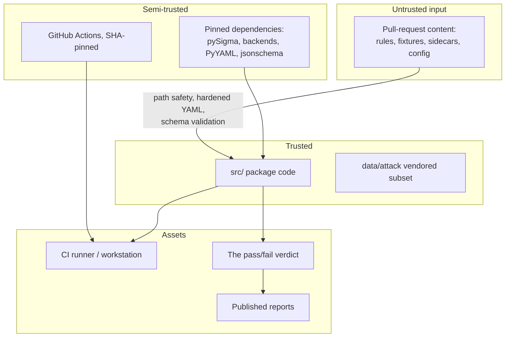

# Threat model

## Scope

The asset being protected is the **machine that runs the laboratory** — a contributor's
workstation or a CI runner — and the **integrity of the verdict** the laboratory produces.

The realistic adversary is a **malicious or malformed repository file**: a rule, fixture,
sidecar, or configuration document that arrives through a pull request and is then
processed automatically by CI.

Out of scope: SIEM product vulnerabilities, production detection efficacy against real
adversaries, and anything requiring live connectivity, because the laboratory has none.

## Trust boundaries

The controls sit on the arrow from untrusted input into the package, and they are applied
**before** content is interpreted.

## Threats and controls

### T1 — Resource exhaustion through crafted YAML

*A rule file uses alias expansion, deep nesting, or an enormous scalar to exhaust CI
memory or CPU.*

| Control | Detail |
|---|---|
| Alias limit | **Zero aliases permitted** — billion-laughs is impossible |
| Depth limit | 32 |
| Node limit | 5000 |
| Scalar limit | 8192 characters |
| Mapping / sequence limits | 512 each |
| File size limit | 1 MiB, checked before reading |
| Enforcement point | During construction, not after parsing |

**Residual risk:** low. Limits are conservative relative to the largest legitimate rule in
the catalog.

### T2 — Regular expression denial of service

*A rule contains a pattern with catastrophic backtracking that hangs the matcher.*

| Control | Detail |
|---|---|
| Length limit | 256 characters |
| Pattern rejection | Nested unbounded quantifiers refused before compilation |
| Failure behaviour | `UNSUPPORTED` result, not a hang or a pass |

**Residual risk:** low-to-moderate. Heuristic detection cannot catch every pathological
pattern. The length limit bounds the worst case, and a job timeout in CI is the backstop.

### T3 — Path traversal or symlink escape

*A configuration path or fixture reference points outside the project root, reading or
writing arbitrary files.*

| Control | Detail |
|---|---|
| Containment | Every path resolved and re-checked against the root |
| Symlinks | Not followed (`allow_symlinks: false`) |
| Path length | 4096 |
| Write paths | `generate-demo` explicitly refuses to write outside the root |
| Failure behaviour | `PathSafetyError` → exit code 3 |

**Residual risk:** low.

### T4 — Code execution through deserialization

*A YAML tag or a fixture causes object instantiation or code execution.*

| Control | Detail |
|---|---|
| Loader | Safe loader with custom tags rejected |
| No `eval`, no `exec`, no dynamic import of repository content |
| No plugin system |
| Fixtures | Parsed as JSON data only |

**Residual risk:** low. The main dependency-side exposure is pySigma parsing the same
text, which is mitigated by pinning and by the size limits applied first.

### T5 — Secret or real-data exposure

*A contributor commits a real credential, hostname, or log excerpt, and it is published in
a report.*

| Control | Detail |
|---|---|
| Secret scanning | `no_secrets` gate over rules and fixtures |
| Real-data scanning | `no_real_data_patterns` gate |
| Redaction | Credential-shaped strings stripped from reports before writing |
| Synthetic marker | Every fixture event must carry `synthetic: true` |
| Reserved namespaces | `.invalid` domains and `192.0.2.0/24` only |

**Residual risk:** moderate. Pattern-based detection cannot recognise every secret format,
and a plausible-looking hostname that happens to be real would pass. Human review remains
necessary; see [security-audit-v1.0.0](security-audit-v1.0.0.md).

### T6 — Evaluator bypass

*A rule uses a construct the matcher does not implement, and the result is reported as
passing.*

This threat is specific to detection tooling and is the one most likely to be
under-appreciated: a bypass here does not compromise a machine, it corrupts the verdict.

| Control | Detail |
|---|---|
| Explicit rejection | Unknown modifiers and out-of-grammar conditions are refused, not ignored |
| Outcome | `UNSUPPORTED`, never `PASSED` |
| Gate | `unsupported_not_counted_as_pass` blocks |
| JUnit mapping | `UNSUPPORTED` renders as `<failure>`, not `<skipped>` |
| Parser | Real grammar, not a regular expression |

**Residual risk:** low. The refusal is default-deny: the parser accepts a defined grammar
and rejects everything else.

### T7 — Report injection

*Rule text containing HTML, a spreadsheet formula, or XML control characters executes or
misrenders in a report.*

| Control | Detail |
|---|---|
| HTML | All values escaped; report is standalone with no script and no external resource |
| CSV | Leading `=`, `+`, `-`, `@` neutralised |
| XML | `xml.sax.saxutils.escape` and `quoteattr` |
| JSON / SARIF | Standard encoding |

**Residual risk:** low.

### T8 — Misclassification of quality findings as vulnerabilities

*SARIF output is uploaded to code scanning and detection-authoring findings appear as
security alerts.*

| Control | Detail |
|---|---|
| No `security-severity` on any rule descriptor |
| Tags | `detection-engineering`, `quality` |
| Properties | `isVulnerabilityFinding: false` on the run and every descriptor |
| Explanatory note embedded in the document |

**Residual risk:** low. Automatic SARIF upload is explicitly out of scope for 1.0.

### T9 — Supply-chain compromise

*A dependency or a GitHub Action is compromised and executes in CI.*

| Control | Detail |
|---|---|
| Exact version pins for all runtime dependencies |
| Actions pinned to full commit SHAs, not movable tags |
| Workflow permissions | `contents: read` |
| No network at runtime, so a compromised dependency has no exfiltration path from the laboratory's own code |
| Documented update process in `config/upstream-versions.json` |

**Residual risk:** moderate. Pinning delays exposure but does not eliminate it; a
compromised release published before the pin was set would still be installed. CI itself
has network access during dependency installation.

### T10 — False confidence in documentation

*Documentation overstates what the laboratory proves, and a reader treats synthetic
results as production validation.*

This is listed as a security threat, not a documentation defect, because false confidence
in detection coverage has operational consequences: a team believes a technique is covered
and stops looking.

| Control | Detail |
|---|---|
| Contractual banners reproduced verbatim in every artefact |
| `production_ready: false` in machine-readable output |
| `status: stable` blocked; maturity capped at `tested-synthetic` |
| Efficacy metrics refused, with the refusal printed |
| Explicitly in scope in `SECURITY.md` |

**Residual risk:** moderate. Controls constrain the artefacts this project produces; they
cannot constrain how a third party summarises them. See
[coverage-methodology](coverage-methodology.md) for language that is accurate and language
that is not.

## Summary

| ID | Threat | Residual risk |
|---|---|---|
| T1 | YAML resource exhaustion | Low |
| T2 | Regex denial of service | Low–moderate |
| T3 | Path traversal / symlink escape | Low |
| T4 | Deserialization code execution | Low |
| T5 | Secret or real-data exposure | Moderate |
| T6 | Evaluator bypass | Low |
| T7 | Report injection | Low |
| T8 | Quality-finding misclassification | Low |
| T9 | Supply-chain compromise | Moderate |
| T10 | False confidence | Moderate |

## Assumptions

- Contributors are not fully trusted; CI processes pull-request content automatically.
- The CI runner is ephemeral and has no access to production systems or secrets beyond
  those the workflow declares.
- Dependencies are trusted at the pinned versions.
- The vendored ATT&CK subset was extracted from the official STIX release.
- Reviewers read the diff. No automated control replaces that.

## Related documents

[security-and-privacy](security-and-privacy.md) ·
[security-audit-v1.0.0](security-audit-v1.0.0.md) ·
[rule-quality-gates](rule-quality-gates.md) ·
[coverage-methodology](coverage-methodology.md)
