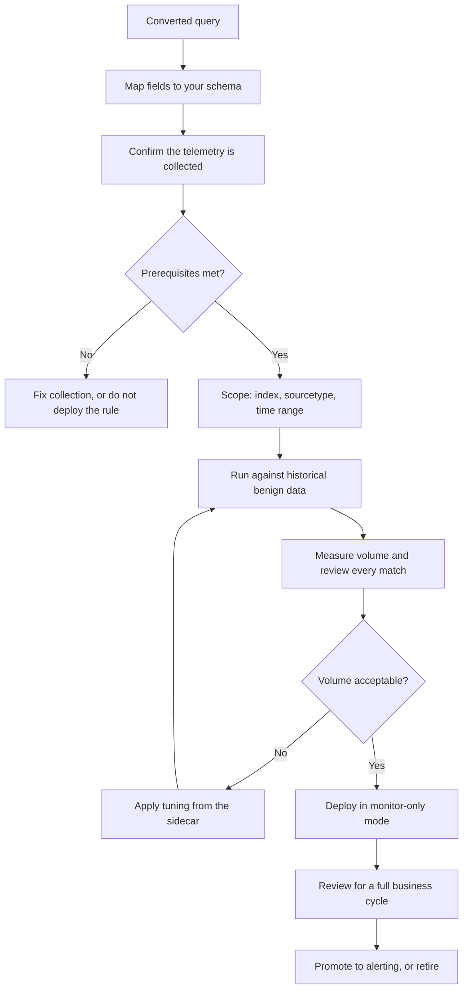

# Tuning and deployment

> **This project does not deploy anything and makes no claim of production readiness.**
> The guidance below is what a deployer would have to do; it is not a deployment
> procedure this repository performs or supports.

Everything in this repository was validated against synthetic telemetry. Taking any of it
towards a real environment is work that happens outside this laboratory, and this document
describes the shape of that work honestly rather than pretending it is a copy-paste step.

## Why converted output is a starting point

A converted query is a translation of a rule's logic into a query language. Between it and
a working detection sit five gaps, described in
[conversion-limitations](conversion-limitations.md): field mapping, index and sourcetype
selection, time range, permissions and cost, and semantic differences between engines.

None of those is a detail. Each one can turn a correct rule into a query that returns
nothing, and a query that returns nothing looks exactly like an environment where the
behaviour is not happening.

## The deployment sequence

### Step 1 — Map the fields

Every field the rule references must resolve in your schema. The sidecar's
`field_semantics` says what each field means, so the mapping is a semantic exercise rather
than a string substitution. `Image` is "the absolute path of the executable backing the
created process" — whichever field in your schema means that is the correct target.

### Step 2 — Confirm the telemetry exists

Check the sidecar's `collection_prerequisites` **before** deploying. If the rule needs
Sysmon Event ID 10 and process access auditing is disabled — which the telemetry catalog
notes is common, because of its volume — the rule will be silent and its silence will be
misread.

Then read `expected_collection_gaps`. Those describe what will be missing even when
everything is configured correctly.

### Step 3 — Scope the query

Add the index or index pattern, the sourcetype, and an explicit time range. Match the time
range to your scheduling interval, with enough overlap to tolerate ingestion lag. For
correlation rules, the scheduler's interval and the rule's `timespan` must be reconciled
deliberately: a 15-minute window evaluated every 15 minutes misses every sequence that
straddles a boundary.

### Step 4 — Backtest against benign data

Run the query over historical data from a period with no known incident. Review **every**
match, not a sample. You are looking for:

- benign matches the sidecar predicted, which validates the false-positive analysis;
- benign matches it did not predict, which need to be added to the analysis;
- zero matches, which usually means a field mapping problem rather than an absence of
  the behaviour.

Zero matches is the result most often misread. Verify the fields resolve by querying them
directly before concluding anything.

### Step 5 — Tune without gutting the rule

Follow the exclusion hierarchy from
[false-positive-engineering](false-positive-engineering.md):

| Rank | Exclusion | Cost |
|---|---|---|
| 1 | Specific binary plus signature or hash | Minimal |
| 2 | Specific binary path | Small |
| 3 | Specific parent-child lineage | Small |
| 4 | Account plus specific behaviour | Moderate |
| 5 | Account alone | Large |
| 6 | Host or host group | Large |
| 7 | Whole directory or logsource | Total — the rule is dead |

Each sidecar's `tuning_guidance` names the destructive exclusion explicitly:

> Prefer per-binary exclusions anchored on `Image|endswith` plus a signature or hash
> condition. Do not exclude the whole `AppData\Local\Temp` prefix, because that removes
> the detection value of the rule entirely.

Every exclusion at rank 4 or below should carry a written justification, an owner, and a
review date. Exclusions accumulate silently and are almost never revisited.

### Step 6 — Deploy in monitor-only mode

Enable the rule without paging. Route matches to a review queue. Run for a full business
cycle — month-end, patch cycle, and any scheduled maintenance window, because those are
precisely when the benign versions of these behaviours occur.

### Step 7 — Promote or retire

Promote to alerting when volume is sustainable, matches are explainable, and there is a
documented response action. Retire if the rule cannot be tuned to a sustainable volume
without gutting it. Retiring is a legitimate outcome; leaving a rule enabled and
permanently muted is not.

## Rules that need particular care

| Rule | Concern |
|---|---|
| `SDEL-WIN-012` | Process access telemetry is very high volume; scope filters are required before this is affordable |
| `SDEL-WIN-001`, `SDEL-WIN-014` | Temporary-directory activity is heavy on developer workstations |
| `SDEL-PS-003`, `SDEL-PS-009` | Script block content varies enormously between environments |
| `SDEL-LX-011` | World-writable directory execution is common in some container images |
| `SDEL-COR-002` | Value-count thresholds need calibration against your authentication volume |
| `SDEL-ID-003`, `SDEL-ID-004` | Group membership changes are routine where governance automation exists |

## Detection-as-code in your environment

If you adopt the approach rather than the rules, the pieces that transfer are:

1. **Version-controlled rules**, reviewed like code.
2. **Sidecar metadata**, so telemetry requirements and tuning guidance live with the rule.
3. **Behavioral fixtures**, adapted to your field names — negative cases especially.
4. **Quality gates** in CI, so authoring standards are enforced rather than requested.
5. **Baseline comparison**, so coverage cannot regress silently.
6. **Deployment records**, so a rule's live state is as reviewable as its source.

Steps 1 to 5 are what this repository demonstrates. Step 6 is out of scope here and is
where most of the operational value ultimately sits.

## Monitoring after deployment

- **Telemetry health.** A rule is only as live as its data source. Silence needs to be
  distinguishable from absence.
- **Match volume trends.** A sudden drop usually means a pipeline change, not an
  improvement in security posture.
- **Exclusion inventory.** Review on a schedule; an exclusion added during an incident is
  rarely removed afterwards.
- **Rule version drift.** Track which version of a rule is deployed against which version
  is in source control.

## What this repository will never provide

- Deployment automation or SIEM API integration.
- Environment-specific field mappings or pipelines.
- Alert routing, case management, or response playbooks.
- Volume predictions or tuning thresholds for your estate.
- Any assertion that a rule works in production.

## Related documents

[conversion-limitations](conversion-limitations.md) ·
[splunk-conversion](splunk-conversion.md) ·
[elasticsearch-conversion](elasticsearch-conversion.md) ·
[false-positive-engineering](false-positive-engineering.md) ·
[logsource-and-telemetry](logsource-and-telemetry.md)
